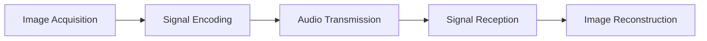

# 🛰️ SSTV Encoder — Deep Space Communication Simulator

> From pixels to signals, and signals back to pixels.

A browser-based image transmission system that demonstrates the principles of spacecraft communication, image telemetry, and signal processing using **Slow-Scan Television (SSTV)**.

Convert an image into audio signals, transmit it through sound waves, and reconstruct it on an Android device using Robot36.

## 🎬 Video Demonstration

[](https://youtu.be/3rFq0aHm104)

▶️ [Watch on YouTube](https://youtu.be/3rFq0aHm104)

## 🚀 Live Demo

[Launch SSTV Encoder](https://aditya-xcity.github.io/SSTV-Encoder/)

## 📡 Mission Specifications

| Parameter | Specification |
|---|---|
| Communication Protocol | SSTV |
| Transmission Mode | Martin M1 |
| Image Resolution | 320 × 256 pixels |
| Signal Modulation | Audio Frequency Modulation |
| Sample Rate | 11,025 Hz |
| Audio Format | 16-bit Mono WAV |
| Transmission Duration | Approximately 115 seconds |
| Receiving Station | Robot36 (Android) |
| Transmission Medium | Acoustic Waves |
| External Dependencies | None |

## 🌌 How It Works



1. **Image Acquisition:** Select an image from your device.
2. **Signal Encoding:** Convert pixel information into frequency-modulated audio tones.
3. **Transmission:** Play the generated audio through a speaker.
4. **Signal Reception:** Capture the audio using a smartphone microphone.
5. **Image Reconstruction:** Decode the received signal using Robot36.

No internet. No Bluetooth. No physical connection between devices.

## ✨ Features

- Real-time image preview
- Martin M1 SSTV encoding
- Image aspect ratio preservation
- Built-in audio playback
- Downloadable WAV files
- Local browser-based processing
- Zero external dependencies
- Acoustic image transmission

## 🛠️ Run Locally

Clone the repository:

```bash
git clone https://github.com/Aditya-xcity/SSTV-Encoder.git
cd SSTV-Encoder
```

1. Open `index.html` in a modern browser.
2. Upload a JPG or PNG image.
3. Click **Generate SSTV WAV**.
4. Play or download the generated signal.

No installation or build process is required.

## 📱 Ground Station Setup

To receive and reconstruct the transmitted image:

1. Install Robot36 on your Android device.
2. Grant microphone access.
3. Select automatic detection or Martin M1 mode.
4. Place your smartphone near the computer speaker.
5. Play the generated audio from the beginning.
6. Wait approximately 115 seconds for image reconstruction.

### Troubleshooting

- Perform the transmission in a quiet environment.
- Maintain moderate speaker volume.
- Disable audio enhancement features.
- Ensure playback is at normal speed.
- Restart the transmission if synchronization fails.

## 📂 Project Structure

```text
SSTV-Encoder/
├── index.html
├── sstv.js
└── README.md
```

| File | Purpose |
|---|---|
| `index.html` | User interface, image preview and playback controls |
| `sstv.js` | SSTV signal generation and WAV serialization |
| `README.md` | Project documentation |

## 🔭 Scientific Context

Slow-Scan Television is a method of transmitting images through encoded signals. SSTV has historically been used in amateur radio and space-related image transmission, including activities aboard the International Space Station.

This project demonstrates related signal encoding and reconstruction principles through acoustic transmission rather than actual deep-space radio communication.

This is an independent educational project and is not affiliated with NASA.

## 👨‍💻 Developer

**Aditya Bhardwaj**

- GitHub: [Aditya-xcity](https://github.com/Aditya-xcity)
- Portfolio: [adityaweb.xyz](https://adityaweb.xyz)

---

⭐ If you find this experiment interesting, consider starring the repository.

**SIGNAL ACQUIRED. IMAGE DECODED. MISSION COMPLETE.**
